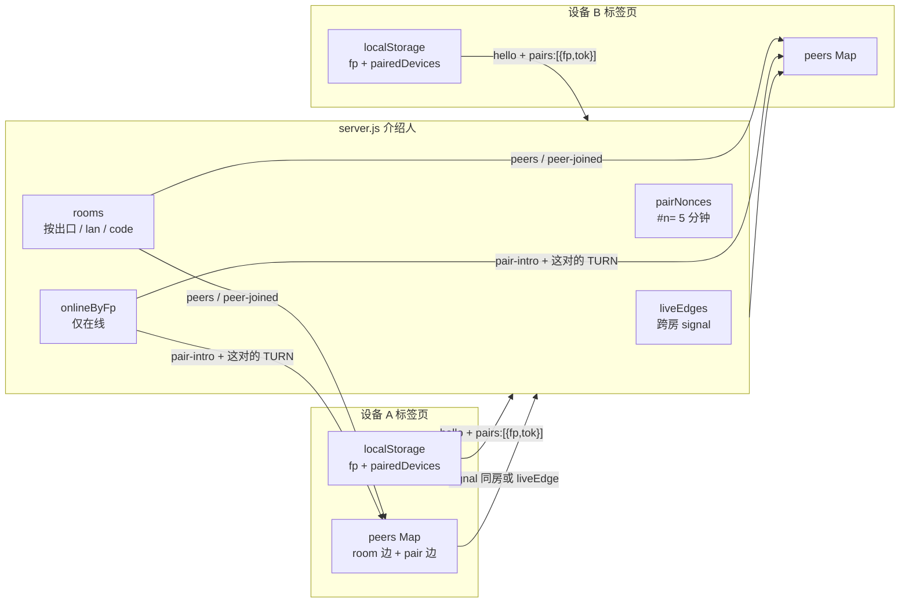
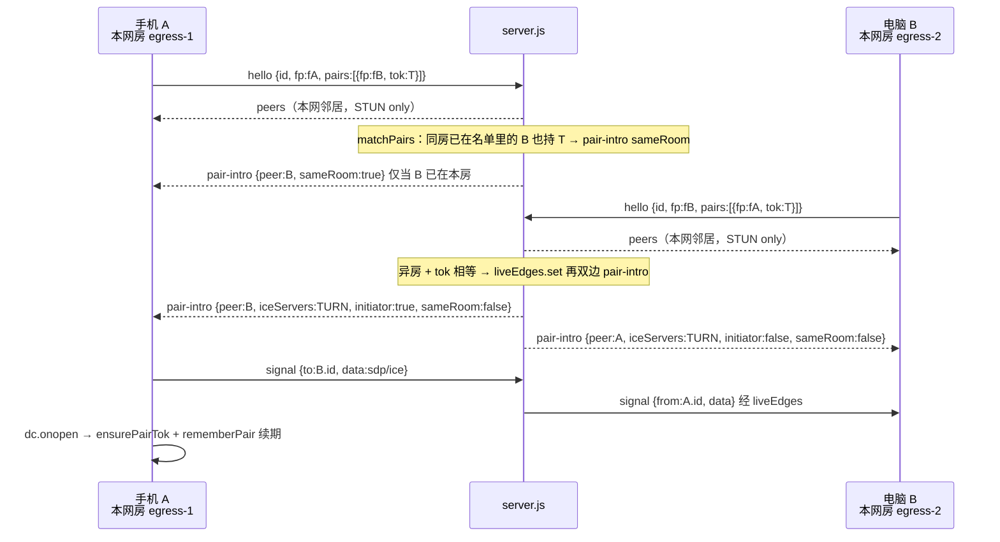
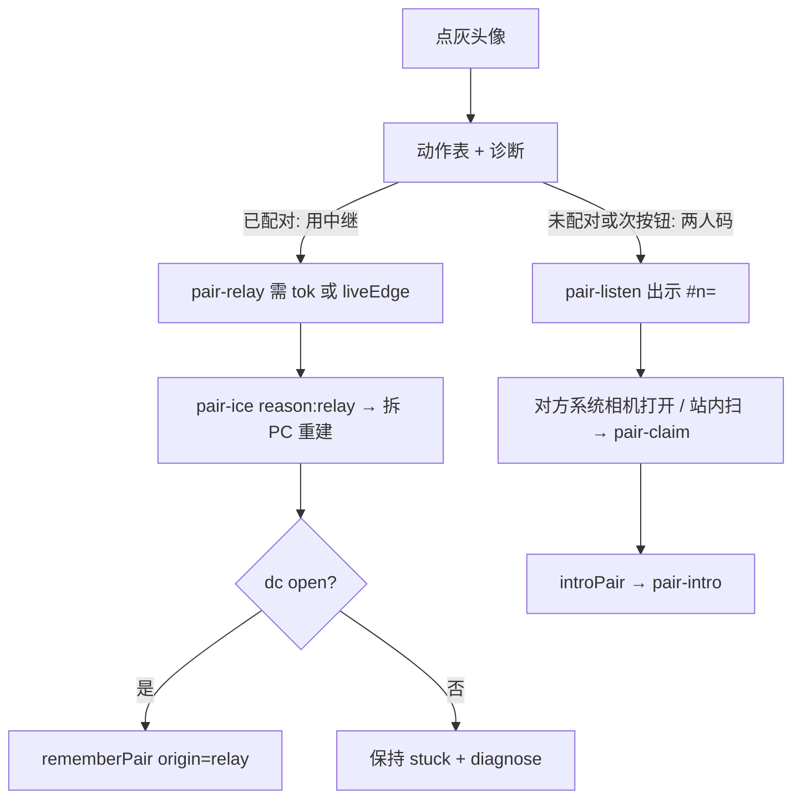
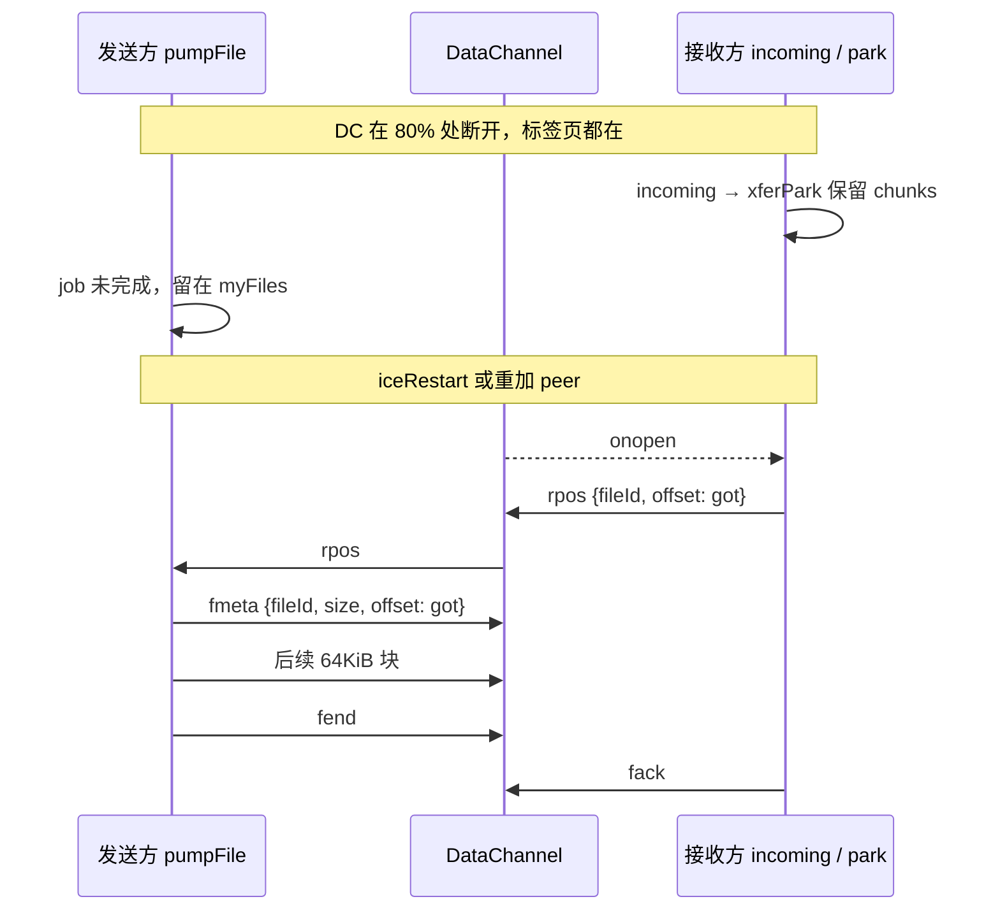

# Zap · 近传 v3 设计：配对记忆 · 一键重连 · 传输续传

| 字段 | 值 |
| --- | --- |
| 文档标题 | Zap · 近传 v3 — 配对记忆 + 一键重连 + 传输可靠性 |
| 作者 | TBD |
| 日期 | 2026-08-17 |
| 状态 | Ready |
| 产品 | [Zap · 近传](https://file.joestudy.net) |
| 仓库 | [sitboy/lanzap](https://github.com/sitboy/lanzap) |
| 前序 | v2 已落地（见 `IMPLEMENTATION-PLAN.md`）。本文是 v3，不重开 v2 已结算项（gossip、通告-拉取、槽位头像、房码房、TURN 两档）。 |

---

## Overview

近传今天把「同一 Wi‑Fi，打开即传」写成主承诺，但浏览器做不到真局域网发现。自动分房靠出口 IP / IPv6 `/64`，再加一次尽力而为的 `maybeLanReunion()`。AP 隔离、访客网、VPN、CGNAT、Chrome mDNS 混淆任何一项失败，用户面对的就是空态 + 一整套「建房 → 出示二维码 → 对方扫」的重恢复路径。配对不记得，下次还要再走一遍；传到一半断线就从字节 0 重来。

本升级不碰发现上限，只补**使用层**的记忆与恢复：

1. **显式配对记住 `fp`**。下次两边都在线，信令按指纹再介绍一次，不必同房、不必同出口。
2. **灰掉的设备可以「就连这一台」**：两人二维码，或给这一对单独开中继。不再每次都交房码房的税。
3. **文案改口**：扫码/输码是主路径，同网自动出现是彩蛋。自动失败不等于产品坏了。
4. **大文件按 offset 续传**（标签页还活着的前提下）。
5. **ICE `iceRestart` 最多 3 次**再标 stuck，减少假死。
6. **「发到我的电脑」**：已配对/已信任的设备置顶，一键当发送目标。

服务器仍然只做介绍人。自动本网房**仍然不下发 TURN**。「文件不经过服务器」对自动路径仍是代码结构，不是口号。配对表只存元数据（客户端权威），服务端跨进程不落盘。

---

## Background & Motivation

### 当前架构（必须对齐的事实）

信令在 `server.js`（188 行）：

- `rooms: Map<key, Map<peerId, ws>>`。键是出口 IP、IPv6 `/64`、`lan:<key>` 或 `code:<ROOM>`。
- `hello` 入房后回 `peers` + `iceServers: iceConfig(manual)`。只有 `manual`（房码匹配 `/^[A-Z0-9]{4,8}$/`）才铸 TURN。
- `signal` **只在同一 `room` Map 里转发**（`sendTo` = `room.get(id)`）。跨房没有边。`ws` 上没有 `_id`；`peerId` 只活在连接闭包里。
- `fp` 已在 `peers` / `peer-joined` 里发给**同房所有人**（`server.js` 101、146 行），但服务器不记住、不索引、不匹配。
- DoS 上限：`MAX_ROOMS=5000`、`MAX_PER_ROOM=50`、`MAX_MSG=256KiB`。
- 心跳 30s；TURN 凭据 2h，约 100 分钟补发 `ice-refresh`（按 `ws._manual`，只刷房间 ICE）。

客户端在 `public/app.js`（约 2010 行）：

- `myId` → `sessionStorage.deviceId`（每标签独立）。
- `myFp` → `localStorage.deviceFp`（`f` + ~10 位 base36，跨标签稳定）。
- `trusted` → `localStorage.trustedFps`（PIN 免码 + 花名册置顶加星）。
- 房码只活在 `#r=`：启动时 `urlRoom = (location.hash.match(/r=([A-Za-z0-9]{4,8})/) || [])[1]`。`#n=` 今天无人读。
- Mesh：`addPeer(info, initiator)`。**后进房的人出 offer**：收到 `peers` 时 `addPeer(pinfo, true)`，收到 `peer-joined` 时 `addPeer(m.peer, false)`。先在房的人等 `ondatachannel`。
- 全局 `iceServers` + `hasTurn()` 决定 stuck 10s|20s 和 `diagnose()`。
- 本网房 `showStuck()===false`，握不上的设备从列表**隐去**；房码房才灰着摆出来，点一下只 `explainStuck`（系统行诊断），没有动作。
- `peers` 对账（993–994 行）：名单里没有的 id 一律 `pc.close()` + `delete`。`ws.onclose → setTimeout(connect, 2000)` **不**走 `reconnectRoom`。
- 传输：64KiB 块、`HIGH_WATER=8MiB`、`fmeta`/`fend`/`fack`；文件夹 `batchId` + `chainStep` + `bslow`/`bgo`。`onWake` 会 `reconnectRoom`，**不续传**。
- `File` / 接收 `Blob` 关页即丢。IndexedDB 只存消息元数据。

公开承诺见 `README.md` / `docs/README.zh-CN.md`：自动同网发现**从不**给中继；扫码组队才给 TURN；走中继必须标「中继连接」，字节仍是 DTLS。

### 痛点（按杠杆）

| 现象 | 根因 | 用户体感 |
| --- | --- | --- |
| 同 Wi‑Fi 看不见对方 | 出口不同 / AP 隔离 / mDNS | 「打开即传」是假的 |
| 看见了但灰掉 / 隐去 | ICE 失败，本网房直接藏 | 没有「就连你」的出路 |
| 昨天扫过码，今天又要扫 | 配对不持久，mesh 跟房间走 | 每次都是第一次 |
| 传 2GB 到 80% 断了 | 无 offset；`reconnectRoom` 丢掉 `p.incoming` | 重头再来 |
| PC 短暂 `failed` | 一次失败就 `p.dc=null`，不 `iceRestart` | 假死 |
| 手机想丢文件给自己电脑 | 必须先选对私聊 | 比传输工具慢一拍 |

### 硬天花板（本升级明确不碰）

- 浏览器没有组播 / mDNS / Bonjour / ARP / 原始 UDP。
- Chrome 把 host candidate 藏成 `.local`；Local Network Access (142+) 是限制不是发现 API。
- 原生 mDNS 伴侣是另一个产品。

---

## Goals & Non-Goals

### Goals

1. 一次显式配对（扫码 / 房码 / 链接 / 就连这一台）之后，关系按 `fp` 记住。两边同时打开页面即可重逢，即使分属不同自动房、不同出口。
2. 灰设备可点：两人码，或「用中继连这一对」。不把用户赶进 `#r=` 房码房（除非他们自己要组多人房）。
3. Hero / 页脚 / 诊断文案改为「扫码为主，同网为彩蛋」。自动失败不再像产品坏了。
4. 同一次浏览会话内，单文件与文件夹支持按 `fileId`/`batchId` + `offset` 续传。
5. ICE `failed`/`disconnected` 后 `iceRestart` 最多 3 次，再标 stuck。
6. 已配对且在线的「我的电脑」成为一等发送目标。

### Non-Goals

- 不突破 Web LAN 发现上限，不加原生助手。
- 不加框架、不加构建、不加数据库进程。
- 服务器仍零内容、零消息、零文件。不引入账号。
- 自动本网房整房不下发 TURN。中继必须来自一次明确动作（历史显式配对也算一次）。
- 不重做聊天壳。只加表面，不改信息架构主骨架。
- 不重开 v2：gossip 形状、通告-拉取、槽位头像、PIN/信任语义保持。
- **不承诺跨刷新续传**。发送方 `File` 句柄与接收方内存块关页即死，这一点对用户说实话。

---

## Key Decisions

1. **跨房边（extra mesh edge），不挪房间。** 配对设备留在各自当前房（本网或房码），信令增加一条按 `peerId` 的跨房转发。群聊（`all` / gossip）仍只发给同房邻居；配对边默认只走私聊。详见 §4.2。
2. **配对权威在客户端，但重介绍必须持有 DC 交换过的 `tok`。** `localStorage.pairedDevices` 为真相；`hello.pairs` 上报 `{fp, tok}`。服务器只维护「此刻在线的 `fp → ws`」和 live edge，**不落盘**。裸 `fp` 互列不够——同房花名册已经泄露 `fp`，冒充对方指纹即可骗 intro。`tok` 只在显式配对的 DataChannel 上生成，服务器只在两端 token 逐字节相等时 `introPair`。
3. **配对 ≠ 信任。** 配对 = 曾经用显式动作握上手并交换过 `tok`；信任 = 可选（PIN 免码 + 星标）。可以只配对不信任。
4. **重介绍带 TURN，且凭据按边续期。** 当初能配上，就是用户同意过「连这两台」。跨房 `pair-intro` 给这一对铸 TURN。同房 intro **不**给 TURN、**不**写 `_pairTurnWith`。`_pairTurnWith` 只在 `pair-relay` 校验通过后挂上。`pair-ice` 带 `reason: 'relay'|'refresh'`：只有 `relay` 才拆 PC；`refresh` 只换凭据，禁止拆掉已 connected 的边。不置 `ws._manual`，不污染本网房的 `peers.iceServers`。
5. **「就连这一台」不进 `#r=`。** 未配对的 stuck → 两人码 `#n=`（双方都在场的明确动作）。已持有 `tok` 或已有 liveEdge 的 stuck → `pair-relay` 给这一对补 TURN。`pair-relay` **不**接受「任意同房 peerId」。`#n=` 冷启动与 `#r=` 对齐：先本网 `hello`，ws OPEN 后再 `pair-claim`。
6. **续传只覆盖「标签页还活着」。** 接收方驱动 `rpos`。刷新 / 杀页 = 发送方丢 `File`、接收方丢块，不能装成能续。
7. **iceRestart 的 offer 方 = 当初 `createDataChannel` 的那一侧。** 房内就是 `addPeer` 第二参（**后进房的人**为 true）。跨房配对边用 `pair-intro.initiator`（`fp` 字典序，只在 intro 时算一次）。同房 `pair-intro` **不得**覆盖已有 `p.initiator`。不在 restart 时改角色。
8. **配对 TTL 30 天滑动。** 家庭设备是周/月节律。`rememberPair` 在显式 DC `onopen`、以及同房 `pair-intro`（`sameRoom:true`）打标时续期。每 `fp` 最多 16 对，超出按 `lastSeen` 淘汰。过期条目从身份面板**静默消失**，不留「已过期，重新扫码」行。
9. **同房互列仍发 `pair-intro`（`sameRoom:true`），不建 liveEdge、不加第二条 PC、不写 `_pairTurnWith`、不改已有 `p.initiator` / `p.iceServersUsed`。** 否则「回家连上同一 Wi‑Fi」不会续期；若误挂 `_pairTurnWith`，续期 `pair-ice` 会拆掉正在工作的本网 STUN。要中继必须再走已鉴权的 `pair-relay`。
10. **`peers` 对账跳过 `edge==='pair'`。** 配对边只听 `pair-gone` / 本地忘记。信令闪断不得拆跨网电脑。
11. **`pair-ice.reason==='relay'` 在 PR3 用拆 PC + `addPeer` 重建**（不依赖 PR5）。`reason==='refresh'` 在 PR3 只写 `p.iceServersUsed`，PR5 再 `setConfiguration`，**永不**对已 connected 的边拆 PC。每条 PC 的 ICE 真相是 `p.iceServersUsed`。

---

## Proposed Design

### 1. 总览



自动房路径不变：`iceConfig(false)` = 仅 STUN（或未配 `TURN_HOST` 时空数组）。配对边的 TURN 走独立下发，见 §4.4。

---

### 2. 身份、配对、信任

| 概念 | 存储 | 生命周期 | 作用 |
| --- | --- | --- | --- |
| `myId` | `sessionStorage.deviceId` | 标签页 | 信令 / mesh 主键。已有，不动。 |
| `myFp` | `localStorage.deviceFp` | 源 + 长期 | 设备指纹。已有，不动。 |
| `trusted` | `localStorage.trustedFps` | 用户开关 | PIN 免码 + 星标置顶。已有。 |
| `paired` | `localStorage.pairedDevices` | **新**，30 天滑动 | 允许服务器按 `fp` 再介绍。 |

`pairedDevices` 形状：

```js
// localStorage.pairedDevices
[
  {
    fp: 'f0k3a1b2c9',          // 对方 deviceFp
    tok: 'xK3…',               // 16 字节 CSPRNG → base64url，22 字符；只经 DC 交换
    name: '呆萌水獭',           // 上次见到的显示名，纯展示
    ua: 'desktop',
    lastSeen: 1723840000000,   // rememberPair 时刷新
    origin: 'qr'               // 'qr' | 'code' | 'link' | 'nonce' | 'relay'
  }
]
```

约束：

- 最多 **16** 条。写入时若满，删 `lastSeen` 最旧的。
- `lastSeen` 超过 **30 天**、或缺少合法 `tok` 的条目，读取时丢弃，不上传，身份面板也不再列出（静默消失，无过期行）。
- 30 天依据：家庭「手机 ↔ 电脑」是周/月节律；固定 7 天会逼用户反复扫码。滑动续期避免「一直在用却过期」。
- **不写 `sessionStorage`**。关标签必须还在。
- 不把整份名单存服务器。`tok` 也不进 URL、不进 `pair-intro`。

写入 / 续期时机（必须是显式动作成功之后）：

- 房码房（`window.__manual`）对该 peer `dc.onopen`；
- 或 `edge==='pair'` 的 `dc.onopen`（`#n=` / 跨房 `pair-intro` / `pair-relay` 成功）；
- 或收到 `pair-intro` 且 `sameRoom:true`：已有同 `peerId` 的 room PC 时**只打标 + 续期**，若 DC 已 open 立刻走 `ensurePairTok`。

**不写入**：纯自动本网握上手。同一 CGNAT 出口下的陌生人不能变成「我的设备」。

**`tok` 交换（DataChannel 帧 `pairtok`）：**

- 只由 `p.initiator===true` 的一侧生成（16 字节 `crypto.getRandomValues` → base64url）。
- 发起方发 `{ t:'pairtok', tok }`；应答方存下并原样回 `{ t:'pairtok', tok }`。
- 本端已有该 `fp` 的 `tok` 则复用，不再生成（重逢续期）。
- 两端不一致（极罕见）：取字典序较小的那个，双方覆写。非法长度直接丢。
- **无 `tok` 不上报、服务器不 intro。** 升级后旧 `pairedDevices`（若有人手工写过）一律当无效，需再扫一次——仓库里本来就没有配对存储。

与 `trusted` 的关系：配对成功**不**自动 `toggleTrust`。星标仍是用户另一次明确动作。`sortedPeers` 改为：信任 > 配对 > 加入顺序。

解除配对：身份面板「已配对的设备」只列出未过期条目，可逐台忘记。超过 30 天未见的条目不出现在列表里（不画过期行）。忘记 = 本地删条目 + 若该 `fp` 现有 `edge==='pair'` 则关 PC + 发 `{type:'pair-forget', fp}`。服务器拆相关 liveEdge，对端收 `pair-gone`。仅改本地、不断现开会让「忘记」变成假动作。

---

### 3. 服务器数据结构

全部进程内。重启即空。客户端 2s 重连 `hello`，在线索引与边在几十秒内重建。

```js
// 已有
const rooms = new Map();           // key -> Map<peerId, ws>

// 新增
const onlineByFp = new Map();      // fp -> Set<ws>   同一浏览器多标签共享 fp
const liveEdges = new Map();       // edgeKey(idA,idB) -> { a:ws, b:ws, turn:boolean }
const pairNonces = new Map();      // nonce -> { ws, exp }
const RELAY_HITS = new WeakMap();  // ws -> { n, t0 }  pair-relay 限速

const MAX_PAIRS_HELLO = 16;
const MAX_LIVE_EDGES = 4000;
const NONCE_TTL_MS = 5 * 60 * 1000;
const MAX_NONCES = 2000;
const RELAY_PER_MIN = 8;
```

`hello` 成功入房后必须写 `ws._id = peerId`、`ws._roomKey = key`、`ws._pairs = parsePairs(m.pairs)`，再 `indexOnline` + `matchPairs`。今日没有 `_id`，跨房转发不能靠闭包里的 `peerId`。

`parsePairs`：只接受 `{fp, tok}` 对象；`fp` `slice(0,40)`；`tok` 须匹配 `/^[A-Za-z0-9_-]{16,64}$/`；按 `fp` 去重；最多 16 条。裸字符串直接丢弃。

`edgeKey(a,b)` = 两个 `peerId` 排序后 `'id1|id2'`。

**驱逐：**

| 结构 | 上限 | 驱逐 |
| --- | --- | --- |
| `onlineByFp` | = 当前连接数 | `bye()` 时从 set 删除，空则删 key |
| `liveEdges` | 4000 条边 | 任一侧 `bye` / `pair-forget` 删除；满则拒新边并下发 `pair-limit` |
| `pairNonces` | 2000 个，各 5 min | 写入时扫过期；满则对出码方下发 `pair-limit`，不发 nonce |
| `hello.pairs` 条数 | 16 | 截断 |
| `hello.pairs[]` 单项 | `fp` ≤40，`tok` 16–64 | 非法丢弃该条 |

`bye()` 现有逻辑后追加：从 `onlineByFp` 摘掉自己；所有含自己的 `liveEdges` 对端发 `pair-gone`；自己发出的未过期 nonce 删掉；`_pairTurnWith` 随 ws 消失。

满额必须有客户端可见的失败：`{ type:'pair-limit', why:'edges'|'nonces' }`。出码方不能举着一个永远扫不中的码。

**为什么不落盘：** 配对名单在两台设备的 `localStorage` 里已经是完整真相。服务器若再写 `data/pairs.json`，就第一次跨会话记住「谁和谁是一对」——和「零存储」公开承诺冲突，换来的只是「客户端没重连时服务器也记得」，而重介绍本来就要求两边都在线。进程挂了，用户刷新即可。JSON 文件还有并发写和备份泄漏（配对图）问题。不值得。

---

### 4. 跨房介绍：两种模型与选定

今日 mesh **按房间封闭**。`signal` 的 `sendTo` 只查当前 `room`。把另一出口的设备「塞进当前会话」是新产品实体：一条**不属于任何房间花名册**的边。

#### 模型 A — 把两人拉进同一合成房

服务器建 `pair:<fpA>:<fpB>`，两边 `leave` 本网房再 `join` 配对房。

- 优点：零改 `signal`，TURN 可沿用 `iceConfig(true)`。
- 缺点：本网群聊里的家人消失；地址栏被改写或出现「人在却不在本网」的谎言；三人家庭会打成两两拆房。这正是「房码房税」。

#### 模型 B — 额外 mesh 边（选定）

每人留在当前房。服务器发现 **token 相等** 且都在线 → `introPair`。`signal` 先查本房，再查 `liveEdges`。

- 优点：本网群还在；跨网电脑以私聊目标出现；自动房 ICE 策略不被整房污染。
- 缺点：`signal` 多一条路径；UI 必须区分「同房邻居」和「配对边」。



**`introPair(a, b)`（必须按此写，否则 SDP 会被静默丢弃）：**

```js
function pairTokOf(ws, otherFp) {
  const rec = (ws._pairs || []).find(p => p.fp === otherFp);
  return rec && rec.tok;
}
function canIntro(a, b) {
  if (!a._fp || !b._fp || a._fp === b._fp) return false;
  const ta = pairTokOf(a, b._fp), tb = pairTokOf(b, a._fp);
  return !!(ta && tb && ta === tb);
}
function sameRoom(a, b) { return a._roomKey && a._roomKey === b._roomKey; }

function introPair(a, b) {
  if (!a._id || !b._id || a === b) return;
  const initiatorA = String(a._fp || a._id) < String(b._fp || b._id);
  const body = (from, to, init) => ({
    type: 'pair-intro',
    peer: { id: to._id, name: to._name, ua: to._ua, hue: to._hue, slot: to._slot, fp: to._fp },
    iceServers: iceConfig(true),
    initiator: init,
    sameRoom: sameRoom(from, to),
  });
  const send = (ws, obj) => { if (ws.readyState === 1) ws.send(JSON.stringify(obj)); };

  if (sameRoom(a, b)) {
    // 同房 signal 已通：不建 liveEdge，不写 _pairTurnWith（那是 pair-relay 成功后的钩子）。
    // 仍必须发 pair-intro，否则 TTL / tok 不会续。客户端必须忽略 initiator 与 iceServers。
    send(a, body(a, b, initiatorA));
    send(b, body(b, a, !initiatorA));
    return;
  }

  const k = edgeKey(a._id, b._id);
  if (!liveEdges.has(k)) {
    if (liveEdges.size >= MAX_LIVE_EDGES) {
      send(a, { type: 'pair-limit', why: 'edges' });
      send(b, { type: 'pair-limit', why: 'edges' });
      return;
    }
    liveEdges.set(k, { a, b, turn: true });
  } else {
    const e = liveEdges.get(k); e.a = a; e.b = b;   // 重连后刷新 ws 引用，幂等
  }
  send(a, body(a, b, initiatorA));
  send(b, body(b, a, !initiatorA));
}

function matchPairs(ws) {
  if (!ws._fp) return;
  for (const rec of ws._pairs || []) {
    const set = onlineByFp.get(rec.fp);
    if (!set) continue;
    for (const other of set) {
      if (other !== ws && canIntro(ws, other)) introPair(ws, other);
    }
  }
}
```

调用点：每次 `hello` 成功入房、写完 `_id/_roomKey/_pairs/_fp`、回完 `peers` 之后。`#n=` 的 `pair-claim` 在 nonce 命中后直接 `introPair`（**不**走 `canIntro`——双方此时还没有 `tok`）。`onlineByFp` 一个 fp 多 ws 时，对每个标签各 intro 一次。

**客户端收到 `pair-intro`：**

- `sameRoom===true` 或 `peers` 已有该 `id`：禁止第二条 PC。置 `p.paired=true`。**忽略**消息里的 `initiator` 与 `iceServers`：`p.initiator` 保持 `addPeer` 原值（后进房出 offer），`p.iceServersUsed` 保持房间 STUN。随手写成 `p.initiator = m.initiator` 会在 PR3 重建 / PR5 iceRestart 上与原 DC 角色对打，重新引入 glare。要中继走 `pair-relay`。DC 已 open → 立刻 `ensurePairTok` + `rememberPair`。
- 否则：`addPeer(peer, initiator, { edge:'pair', iceServers })`。配对边头像色用 `hashId(fp)`，忽略对方房的 `slot`（`pickSlot` 按房分配，原样用会撞色）。

**群聊范围：** `targets()` **和** `broadcastFrame` 共用 `p.edge!=='pair'`。只改 `targets()` 会让 gossip / `offer` / `pull` 仍打到蜂窝设备。配对边 `onmessage` 只接受 `dm` / 文件帧 / `pairtok` / `rpos` / `gone`；收到 `text`/`offer`/`boffer`/`pull`/`bpull` 丢弃且不转发。

点那台设备进私聊，行为与今日 DM 完全一样。

UI（最小增量）：

- 移动端仍是 `#peers` 横条。排序：信任 > 配对 > 其他。配对且非同房的头像右下角加小链标（CSS，不新开一栏）。
- 桌面 `#dl-items`：若同时存在配对边与本网邻居，中间插一行分组标题「已配对」/「本网」（`my_devices` / `devices_title`）。无配对边时布局与现在一致。
- 不进当前群会话，不当第二个「所有人」。点头像 = 已有 `switchConv(id)`。

离线的已配对设备**不**占花名册（没有 `peerId`，也无法发）。身份面板只列出未过期的配对，可忘记；过期条目直接不在，没有「重新扫码」残行。这避免一排永远灰着的幽灵。

---

### 5. 线协议 — WebSocket

现有类型不动：`hello`、`rename`、`signal`、`peers`、`peer-joined`、`peer-left`、`peer-renamed`、`ice-refresh`。

#### 5.1 `hello` 扩展

```js
// 客户端 → 服务器（已有字段全保留）
{
  type: 'hello',
  id, name, ua, hue, fp,
  room?: 'AB12C',          // 已有，进房码房
  lan?: 'l…',              // 已有，子网重聚
  pairs?: [{ fp: 'f0k3a1b2c9', tok: 'xK3…' }]  // 新：最多 16；无 tok 的项丢弃
}
```

入房逻辑**一字不改**（仍按 `room` / `lan` / `autoKey`）。入房成功后：

1. `ws._id = peerId`，`ws._roomKey = key`，`ws._pairs = parsePairs(m.pairs)`；
2. 回 `peers`（`iceServers: iceConfig(manual)` —— 自动房仍无 TURN）；
3. `indexOnline(ws)` + `matchPairs(ws)`。

房间 `ice-refresh` 继续只按 `ws._manual` 刷**房间** ICE。配对边走独立的 `pair-ice` 补发（见 §5.4），避免把 TURN 写进本网房客户端的全局 `iceServers`。

#### 5.2 `pair-intro` / `pair-gone` / `pair-limit` / `pair-forget`

```js
// 服务器 → 两端
{
  type: 'pair-intro',
  peer: { id, name, ua, hue, slot, fp },
  iceServers: [/* iceConfig(true)；配了 TURN_HOST 时必须含 turn: */],
  initiator: true | false,  // fp 字典序较小者为 true；只在 intro 时算一次
  sameRoom: true | false
}

{ type: 'pair-gone', id: 'dxxxx' }
{ type: 'pair-limit', why: 'edges' | 'nonces' }

// 客户端 → 服务器（忘记设备）
{ type: 'pair-forget', fp: 'f…' }
```

`addPeer` 增加可选第三参；缺省与现在一致（全局 `iceServers`，`edge:'room'`）。`pair-gone`：仅当该 id 的 `edge==='pair'` 时拆；若同房花名册里还有这个 id，忽略。`pair-forget`：按 `fp` 拆本 ws 与对方之间的 liveEdge，对端 `pair-gone`。

#### 5.3 `pair-listen` / `pair-claim` 与 `#n=` 冷启动

```js
{ type: 'pair-listen' }
{ type: 'pair-nonce', nonce: 'K7M2QX' }   // 6 位 A-Z0-9，去掉 01OIL
{ type: 'pair-claim', nonce: 'K7M2QX' }
{ type: 'pair-miss' }                     // 过期 / 用过 / 不存在 / 自己扫自己
```

二维码 URL：`https://file.joestudy.net/#n=K7M2QX`。

**启动契约（与 `#r=` 对齐，主路径是系统相机 / 微信打开链接，不是站内扫）：**

```js
let urlRoom = (location.hash.match(/r=([A-Za-z0-9]{4,8})/) || [])[1] || '';
let urlPairNonce = (location.hash.match(/n=([A-Za-z0-9]{6})/) || [])[1] || '';

function consumePairHash() {
  if (!/#n=/i.test(location.hash)) return;
  history.replaceState(null, '', location.pathname + (urlRoom ? '#r=' + urlRoom : ''));
}
function claimPendingNonce() {
  if (!urlPairNonce || !ws || ws.readyState !== 1) return;
  const n = urlPairNonce.toUpperCase();
  urlPairNonce = '';
  consumePairHash();
  ws.send(JSON.stringify({ type: 'pair-claim', nonce: n }));
}
```

顺序：先按本网房（或已有 `#r=`）发 `hello` → `ws` OPEN 后 `claimPendingNonce`。成功则两端 `pair-intro`；失败弹 `pair_miss`。`#n=` **绝不**当成 `hello.room`。

`startScan` 命中 `#n=` 或裸码不是房码时，写入 `urlPairNonce` 并调同一 `claimPendingNonce`。手输框继续只当房码，避免 6 位裸码歧义。

nonce：一次性、5 分钟、每 ws 一个。出码方关页或再听一次即作废旧码。满 `MAX_NONCES` 回 `pair-limit`，不发码。出码方不把 `#n=` 写进常驻 hash。

#### 5.4 `pair-relay` / `pair-ice`（已配对的这一对补 TURN）

```js
{ type: 'pair-relay', to: 'dxxxx' }   // 请求方眼里的对端 peerId
// pair-ice.to = 接收方眼里的对端 peerId（A 收到 B._id，B 收到 A._id）。禁止同一份 JSON 发给两边。
{ type: 'pair-ice', to: 'dxxxx', iceServers: [/* iceConfig(true) */], reason: 'relay' | 'refresh' }
```

`to` 在客户端是 `peers.get` 的键，`peers` 里只有对方、没有自己。必须按接收方分别填写：

```js
function sendPairIce(a, b, reason) {
  const ice = iceConfig(true);
  const send = (ws, otherId) => {
    if (ws && ws.readyState === 1)
      ws.send(JSON.stringify({ type: 'pair-ice', to: otherId, iceServers: ice, reason }));
  };
  send(a, b._id);   // A 的 peers.get(B._id) 才找得到那条 PC
  send(b, a._id);
}
```

`relay` 与 `refresh` 共用此函数。单测：发出的两帧 `to` 互为对端 id，不得相等、不得等于接收方自己的 `_id`。

**服务端接受 `pair-relay`，当且仅当：**

1. `to` 是 ≤40 的字符串，目标 ws 存在且 OPEN；且
2. `canIntro(ws, dest)`（两端 hello 里的 `tok` 相等），**或** `liveEdges` 已有 `(ws._id, dest._id)`；且
3. 该 ws 滚动分钟内 < 8 次。

**不接受**「只是同房」。改装客户端不能对 CGNAT 室友刷 TURN。未配对的 stuck 走 `#n=`（claim 本身是双方在场的同意）。

通过后（**这是唯一写 `_pairTurnWith` 的地方**）：

```js
(ws._pairTurnWith || (ws._pairTurnWith = new Set())).add(dest._id);
(dest._pairTurnWith || (dest._pairTurnWith = new Set())).add(ws._id);
sendPairIce(ws, dest, 'relay');
```

不置 `ws._manual`。未配 `TURN_HOST` 仍发 `pair-ice`（可能只有 STUN），客户端走 `diag_no_relay`。

**客户端必须按 `reason` 分叉，禁止一律拆 PC：**

```js
function onPairIce(m) {
  // m.to = 对端 peerId（服务器按接收方分别填）。peers 里没有自己。
  const p = peers.get(m.to);
  if (!p) return;
  if (m.reason === 'relay') applyPairIceRelay(p, m.iceServers);
  else applyPairIceRefresh(p, m.iceServers);   // reason === 'refresh' 或缺省
}
function applyPairIceRelay(p, iceServers) {     // 仅用户点「用中继」
  p.iceServersUsed = iceServers;
  parkTransfersForPeer(p);
  const info = { id: /* p 的 id */, name: p.name, ua: p.ua, hue: p.hue, slot: p.slot, fp: p.fp };
  const initiator = p.initiator, edge = p.edge;
  teardownPc(p, { keepPeer: false });
  addPeer(info, initiator, { edge, iceServers });
  // 新 DC onopen → rememberPair(..., origin:'relay') + flushResume(p)
}
function applyPairIceRefresh(p, iceServers) {   // interval 凭据续期
  p.iceServersUsed = iceServers;
  // PR3：到此为止。禁止 close / addPeer。
  // PR5：若 pc 还在，pc.setConfiguration({ iceServers })。已 connected 的边保持不动。
}
```

PR5 把 `applyPairIceRelay` 的拆 PC 换成 `setConfiguration` + 仅 `p.initiator` 侧 `createOffer({ iceRestart:true })`。不 `setConfiguration` 的 iceRestart 仍只有旧 STUN，一键中继会是空操作。

**凭据续期：** 现有 100 分钟 interval 追加：每条 `liveEdges` 调 `sendPairIce(edge.a, edge.b, 'refresh')`；每个 `ws._pairTurnWith` 里的对端（**只有点过中继的同房对**）找到 dest ws 后同样 `sendPairIce(ws, dest, 'refresh')`。已对某对发过则跳过，避免 liveEdge 与 `_pairTurnWith` 双发。**不要**写进房间 `ice-refresh`。`refresh` 不得拆已 connected 的 STUN 或 TURN 边。PR3 阶段只存新凭据，下一次**用户触发的**重建才用——桌面挂一天的配对边在 PR5 前可能在 2h 后新建失败，这是可接受的分阶段缺口，PR5 必须用 `setConfiguration` 补上。

`hasTurn(p)` / stuck 时限 / `diagnose(p)` 一律读 `p.iceServersUsed`，禁止再读全局 `iceServers`。

#### 5.5 `signal` 路由

跨房不能复用闭包 `sendTo`（它绑的是本连接的 `room`）。

```js
} else if (m.type === 'signal' && peerId && m.to) {
  const to = String(m.to).slice(0, 40);
  if (room && room.has(to)) {
    sendTo(to, { type: 'signal', from: peerId, data: m.data });
  } else {
    const edge = liveEdges.get(edgeKey(peerId, to));
    const dest = edge && (edge.a._id === to ? edge.a : edge.b);
    if (dest && dest.readyState === 1)
      dest.send(JSON.stringify({ type: 'signal', from: peerId, data: m.data }));
  }
}
```

`MAX_MSG` 仍适用。无边静默丢弃。`matchPairs` / `pair-claim` 必须先 `liveEdges.set` 再发 `pair-intro`，否则 SDP 全丢。

---

### 6. 一键「就连这一台」

今日 `showStuck = () => !!(window.__manual && window.__room)`。跨网配对边 ICE 失败时人在自动房，灰头像会被隐去，一键入口随之消失。改成**带 peer 的谓词**：

```js
function showStuck(p) {
  if (window.__manual && window.__room) return true;
  if (p.edge === 'pair' || isPaired(p.fp)) return true;
  const live = [...peers.values()].filter(x => !x.stuck).length;
  const stuckN = [...peers.values()].filter(x => x.stuck).length;
  return live === 0 && stuckN > 0;   // 落单只剩灰的：显示恢复入口
}
```

`renderPeers` 里 `if (p.stuck && !showStuck(p)) continue`。

| 场景 | 现在 | v3 |
| --- | --- | --- |
| 房码房 stuck | 显示，点 = 诊断文本 | 显示，点 = 动作表 |
| 本网房 stuck 陌生人 | **隐去** | 仍隐去（除非整房只剩灰的） |
| 本网房 stuck 且已配对 / `edge==='pair'` | 隐去 | **显示**，点 = 动作表 |
| 本网房 stuck 且可见在线数为 0 | 全隐，只剩 hero | 显示这些灰设备 |

`explainStuck` 升级为小卡片（复用 `#mask`，不新做一套 modal）：

- 标题：`{name}` + `st_stuck`；诊断走 `diagnose(p)`（读 `p.iceServersUsed`）。
- **已配对**（`isPaired(p.fp)` 或 `p.edge==='pair'`）：主按钮 **「用中继连这台」** → `pair-relay`；次按钮两人码。
- **未配对**：只给 **「出示两人码」**。不给中继按钮——服务端也会拒。
- 技术摘要 `candSummary` 仍用 `sysDetail`。



---

### 7. 大文件 / 文件夹续传

#### 7.1 能活、不能活（必须诚实）

| 故障 | 发送方 `File` | 接收方数据 | 能否续 |
| --- | --- | --- | --- |
| DC / ICE 掉，两边标签页都在 | 在 | 内存块 / dir 句柄在 | **能** |
| `onWake` → `reconnectRoom`（同一标签） | 在 | 若不 park 会丢；park 后在 | **能**（本设计要修的洞） |
| 接收方杀页 / 整页重载 | 在 | 单文件块没了；zip 没了 | **不能**。卡片保持 `recv_incomplete` / `interrupted` |
| 发送方杀页 / 重载 | **`File` 没了** | 可能还有半截 | **不能**。现有 `expired` + 重选文件 |
| 文件夹 + `showDirectoryPicker` 落盘 + 仅 DC 掉 | 在 | 已写完的子文件在磁盘 | **能**（从下一文件 / 当前文件 offset） |
| 文件夹 + zip 内存 + 杀页 | 看发送方 | zip 没了 | 不能 |

IndexedDB 不存文件块（配额、主线程、隐私）。不引入 OPFS 当通用后备（iOS Safari 能力差，且超出「最小改动」）。

#### 7.2 现有发送循环要对齐的点

`pumpFile`（`app.js`）今天从 `off=0` 走到 `size`，先 `fmeta` 再 64KiB `slice`，最后 `fend` + `awaitAck`。`HIGH_WATER=8MiB`，`waitDrainBelow` 已有断线兜底。

`pumpBatch` 按 `b.items` 顺序，每项 `fmeta`（带 `batchId`+`path`）+ 字节，**不发**每文件 `fend`，整批一个 `bend`。接收方 `chainStep` 串行落盘，`st.cur.got >= st.cur.size` 切文件。

`reconnectRoom` 关所有 PC 并 `peers.clear()`，**`p.incoming` / `p.binc` 直接丢掉**。`myFiles` / `myBatches` / `recvBatches` 还在。续传的第一刀是 **park**，不是改块大小。

#### 7.3 Park 与拆 PC 入口

所有拆 PC 的路径必须先 `parkTransfersForPeer(p)`：`reconnectRoom`、`peers` 对账（仅 room 边）、`peer-left`、`applyPairIceRelay`（**不是** `refresh`）、`onconnectionstatechange=failed` 且不再 restart。抽一个 `teardownPc(p, {keepPeer})`，禁止再裸写 `p.pc.close()`。

```js
const xferPark = new Map(); // key: fileId | batchId；不进 localStorage
// 接收侧（按发送方 fp 归属，peerId 会随对方新标签变化）
// file:  { kind:'file', got, chunks, meta, conv, fromFp }
// batch: { kind:'batch', st, fromFp }  // 整份 recvBatch：sink / chain / cur / pending
```

`parkTransfersForPeer(p)` 写 `fromFp: p.fp`。没有 `p.fp` 的边不 park（无法安全续）。按 `fileId`/`batchId` 索引，**不按 `peerId`**。`dc.onclose`：把 `p.incoming` 挪进 park，带上 `fromFp`，不要丢 `chunks`。

发送侧：`pump()` 今日先 `shift` 再跑，DC 死会 `throw`，job 出队。改为 catch 里若 `job.file` / `job.batch` 仍在 `myFiles`/`myBatches`，写回：

```js
info.incomplete = { offset: job.offset || off, done: job.done || 0, toFp: p.fp };
```

卡片 `resuming()`，**不要** `sendFailed`。没有 `p.fp` 则不写 `incomplete`（无法判断发给谁）。`awaitAck` 在 DC 非 open 时改为同一条 `resuming` 路径，撤掉 interval，禁止 `sendFailed`（除非用户取消或**该 fp 对应的发送方**回 `gone`）。

**群通告一人文件、多人 `pull`（v3 下限）：** 每个 `fileId` 同时只跟踪**一个** downloader 的 offset（`incomplete.toFp`）。后来的 `pull` 仍从 0 推一条新 job，**不**覆盖、不抢那个槽。不要假装能给 N 个拉取者各记一份进度。

定时器清单（park / restart / 拆 PC 时一律 `clearTimeout` 再在恢复后重武装）：

- `awaitAck` 的 interval
- 文件夹 `st.stall`（默认 25s，开批 12s）——不撤就会在 ICE 重建期间 `failRecvBatch` 清掉 park
- 群拉取 9s `unavailable`（`offerCards[].timer`）

#### 7.4 接收方驱动的 `rpos`

DataChannel 新帧（均 ≤ 256B 级，走已有 JSON 字符串通道）：

```js
// 接收方 → 发送方，dc 一 open（或收到 fmeta 且本地已有进度）立刻发
{ t: 'rpos', fileId: 'f…', offset: 1234567 }

// 文件夹：已完成的子文件数 + 当前子文件已写字节
{ t: 'rpos', batchId: 'b…', done: 12, fileId: 'b…_12', offset: 4096 }

// 发送方发现 File 没了（自己刷新后只剩通告）
{ t: 'gone', fileId: 'f…' }          // 或 batchId
```

规则：

- `offset` 必须是 `0…size` 的整数。非法则接收方丢 park，当新传。
- 发送方 `pumpFile` 增加 `job.offset`（默认 0）。`fmeta` **回带** `offset`，让接收方核对「我会从这儿接着吐」：

```js
p.dc.send(JSON.stringify({
  t: 'fmeta', fileId, name, size, mime, offset: job.offset || 0
}));
let off = job.offset || 0;
```

- 接收方若 `park.got !== fmeta.offset`：取 `min` 并截断 `chunks`（或对 dir sink 不截已落盘文件——见下），不一致超过 64KiB 则放弃 park、从头并打系统行 `resume_reset`。
- **不改块大小、不改 `HIGH_WATER`、不改 `fack` 语义。** 续传成功结束仍是一次 `fend` + `fack`。`awaitAck` 继续按 `fileId`。
- 群通告拉取（`pull`）同样适用：下载中途 DC 掉，卡停在 `downloading`；DC 回来后接收方发 `rpos`，发送方 `streamFileTo` 带 offset。今日 9s `unavailable` 计时在 restart 时清掉重武装。

文件夹：

- `rpos.done` = 已完整关闭的子文件数。发送方 `pumpBatch` 从 `items[done]` 起，当前项从 `offset` 起。
- dir sink 两支：
  - `st.cur.w` 仍是活的 `FileSystemWritableFileStream`：继续 `write`；
  - PC 已拆、writable 作废：`fileHandle.createWritable({ keepExistingData:true })`，再 `write({ type:'write', position: offset, data })`。没有 `fileHandle`（zip 或未选目录）则不能 seek，整文件重来。
- zip sink：标签页活着靠内存 `ZipStore` 续。杀页则 `interrupted` + 整批重来。zip 的 park 是整份 `st`，不是单文件 `chunks` 数组。
- `bend.skipped` 语义不变。



#### 7.5 与 `chainStep` / 背压

`p.paused` + `bslow`/`bgo` 不改。续传只是让 `pumpBatch` 的起点不是 0。`FLOW_HIGH`/`FLOW_LOW` 仍看 `st.pending`。

发送方若在 `pumpFile` 中途因 DC 死抛错：今日会 `sendFailed`。改为：若 `job.file` 仍在，卡片进 `resuming`，**不要**清 `myFiles`。仅当 `gone` 或用户取消才 `sendFailed`。

```js
function flushResume(p) {
  if (!p.dc || p.dc.readyState !== 'open' || !p.fp) return;
  for (const [id, park] of xferPark) {
    if (park.fromFp !== p.fp) continue;          // 只向真正的发送方要续
    if (park.kind === 'file')
      p.dc.send(JSON.stringify({ t: 'rpos', fileId: id, offset: park.got }));
    else
      p.dc.send(JSON.stringify({
        t: 'rpos', batchId: id, done: park.st.done,
        fileId: park.st.cur && park.st.meta && (park.st.meta.batchId + '_' + park.st.done),
        offset: park.st.cur ? park.st.cur.got : 0
      }));
  }
}
function requeueIncomplete(p) {
  if (!p.fp) return;
  for (const info of myFiles.values()) {
    if (info.incomplete && info.incomplete.toFp === p.fp) {
      p.queue.push({ file: info.file, fileId: info.meta.fileId, card: info.card,
                     offset: info.incomplete.offset || 0, toFp: p.fp });
      info.incomplete = null;
    }
  }
  for (const b of myBatches.values()) {
    if (b.incomplete && b.incomplete.toFp === p.fp) {
      p.queue.push({ batch: b, batchId: b.meta.batchId, card: b.card,
                     done: b.incomplete.done, offset: b.incomplete.offset || 0, toFp: p.fp });
      b.incomplete = null;
    }
  }
  pump(p);
}
```

`flushResume` 在 `dc.onopen` **和** `pc.onconnectionstatechange === 'connected'` 都调——iceRestart 可能复用同一条 DC，`onopen` 不会再触发。收到 `rpos` 后，仅当本端 `myFiles`/`myBatches` 仍握着对应 `File` 时 `requeueIncomplete`；**本端没有该 `File` 才回 `gone`**（对方刷新丢句柄）。B 不是发送方时不得对 A 误来的 `rpos` 回 `gone`——有 `fromFp`/`toFp` 过滤后不应再出现这种帧；若仍收到未知 `fileId` 的 `rpos`，静默丢弃，不回 `gone`。`gone` 到接收方：仅清 **该 `fromFp`** 对应的 park / 卡片 `file_gone`。

---

### 8. ICE restart

今日 `addPeer`：

```js
pc.onconnectionstatechange = () => {
  if (['failed', 'closed'].includes(pc.connectionState)) { p.dc = null; renderPeers(); }
};
```

`failed` 一次即废。Chrome 在网络抖动时经常先 `disconnected` 再 `failed`，一次 `restartIce()` 就能活。

#### 规则

- 在 `addPeer` 里记 `p.initiator`（第三个参数或原第二参）、`p.iceTries=0`、`p.iceServersUsed`。
- `disconnected`：2s 后若仍非 `connected`/`connecting`，发起 restart。
- `failed`：立即 restart。
- `closed`：不 restart（本地主动关）。
- 最多 **3** 次。每次重置 stuck 定时器。3 次仍死 → `p.stuck=true`，走今日诊断。
- `connected`：`iceTries=0`。
- **只有 `p.initiator===true` 的一侧 `createOffer({iceRestart:true})`。** 对端走现有 `handleSignal` 的 offer→answer。`p.initiator` = `addPeer` 第二参原样保存：房内即「后进房的人」（`peers` 回调里 `true`，`peer-joined` 里 `false`）；配对边用服务器 `pair-intro.initiator`。两侧同时 restart 会造成 offer glare，今日没有 rollback。
- `pc.restartIce()` 后 `createOffer({iceRestart:true})` → `setLocalDescription` → 已有 `signal` 包。
- 进行中的 offer/answer 未完成时不叠第二次（`p.iceBusy` 锁）。

与续传：restart 成功则同一 PC 上 DC 可能复用，也可能换一条。`flushResume(p)` 必须在 `onopen` **和** `connectionState==='connected'` 都调。`setupDC` 的 `onopen` 可重入：清 stuck、`advertiseCatalogTo`、`ensurePairTok`、`trackVia`。

与 stuck 定时器：`hasTurn(p)` 读 `p.iceServersUsed`；有 TURN 的边 20s 才标灰。restart 期间不要提前 `p.stuck=true`。每次 restart 先 `pc.setConfiguration({ iceServers: p.iceServersUsed })`。

---

### 9. 「发到我的电脑」

不改聊天壳。在已有 `#tools` 行（移动）/ 桌面工具条加一个**有条件显示**的按钮 `#send-home`。

候选 = 已配对或已信任、且 DC open。

- **0 台** → 按钮 `display:none`。
- **正好 1 台** → 按钮文案 `send_to_device` + 短名（若 `ua==='desktop'` 且我是手机，可用 `send_to_computer`）。点击：不强制 `switchConv`；`fileInput.click()`；一次性 `sendOverrideConv`；成功后写 `lastSendTargetFp`。
- **多于 1 台** → **不要静默选一台**。按钮打开短列表（名字 + 设备类型），点谁发给谁。`lastSendTargetFp` 只用于把上次目标排在列表第一，不当暗默认。

不做单独「设备管理页」。误发没有云端撤回（P2P 已经到了）；选错只能靠发送前这一次选择。多桌面默认哪一台不再是 Open Question。

---

### 10. 文案 / Hero / README

原则：扫码是主路径；同网自动出现是加成；**不推翻**「自动发现永不给中继」。

改已有键（`public/i18n.js`；设计稿给出 zh + en，落地时 18 种语言同一批改，缺键回落 `I18N.en`）：

| key | zh 现状 | zh 新 | en 新 |
| --- | --- | --- | --- |
| `hero_title` | 同一 WiFi，打开即传 | 扫一扫，立刻传 | Scan & send |
| `hero_desc` | 用其他设备打开 {url}，就会自动出现在这里… | 用另一台设备扫码，或打开 {url}。同一网络下常常会自己出现——没有也没关系，扫一下就行。 | Scan from the other device, or open {url}. On the same Wi‑Fi they often appear on their own — if not, just scan. |
| `hero_scan` | 扫一扫 · 连接设备 | 扫一扫 · 连接设备（不动） | Scan to connect |
| `searching` | 正在搜索同网设备… | 同一网络的设备出现时会显示在这里 | Nearby devices will show up here |
| `only_you` | 当前网络里只有你 | 还没有连上其他设备 | No other device connected yet |
| `room_auto_hint` | 同一 WiFi 的设备已自动出现，无需组队… | 扫码或输入房码即可配对，下次两边打开就会自己连上。同一 Wi‑Fi 下常常不用扫。 | Scan or enter a room code to pair — next time both sides just open the page. On the same Wi‑Fi you often will not need to. |
| `no_direct` | …本工具仅支持同一 WiFi 内互传。 | 现在连不上 {name}。扫码或点「用中继连这台」。 | Can’t reach {name} right now. Scan, or tap “Relay this pair”. |
| `invite_tip` | 让对方扫这个码，或用房码加入 | 让对方扫这个码。配对一次，以后两边打开就能传。 | Have them scan this code. Pair once, then just open the page next time. |
| `diag_mdns` / `diag_isolated` | 结尾「用组队扫码配对可以绕开」 | 改为同时点出「就连这一台 / 扫码」（语义不变，去掉「本工具只能同网」的口气） | 同左 |

**不改**（承诺锚点）：`direct`、`st_relay`、`relay_notice`、`st_p2p`。页脚继续「点对点直连 · 文件不经过服务器」；走中继时 `trackVia` 仍播一次 `relay_notice`，设备行仍标 `st_relay`。

README（`README.md` + `docs/README.zh-CN.md`，其它 16 份语言 README 同批改 slogan / Features 第一句）：

- Slogan：中文「扫一扫，立刻传。同一 Wi‑Fi 是彩蛋。」英文 “Scan & send. Same Wi‑Fi is a bonus.”
- Features 里「组队三通道」改为四通道：扫码 / 房码 / 链接 / 同网自动出现（自动放最后）。
- **Scope 表加一行，不改前两行：**

| 连接方式 | ICE | 字节 |
| --- | --- | --- |
| 自动发现的本网房 | 只有 STUN | 永远设备到设备 |
| 显式组队（扫码 / 房码 / 链接） | STUN + TURN | 能直连就直连；中继兜底并标注 |
| **重介绍的已配对边，或「用中继连这台」** | **STUN + TURN（只这一对）** | **同上；本网房其他人仍无 TURN** |

「自动发现的本网房从不下发中继」原句保留。

#### 新 i18n 键（至少 zh + en；18 语言都要有键，可先英文化再润）

```js
// zh
my_devices:'已配对',
paired_tag:'已配对',
unpair:'忘记这台设备',
unpair_confirm:'忘记后，下次需要重新扫码才能跨网找到它。确定？',
connect_relay:'用中继连这台',
connect_qr:'出示两人码',
pair_qr_tip:'让对方扫这个码，只连你们两台，不用进房间。',
pair_miss:'这个码过期了或已经用过，请让对方重新出示。',
pair_limit:'现在配对的人太多，请稍后再试。',
send_to_device:'发到 {name}',
send_to_computer:'发到我的电脑',
resuming:'连接恢复，继续传输…',
resume_reset:'进度对不上，已从头传输',
file_gone:'对方已刷新，无法续传，需要重新发送',
forget_paired:'已配对的设备',
```

```js
// en
my_devices:'Paired',
paired_tag:'Paired',
unpair:'Forget this device',
unpair_confirm:'You will need to scan again to find it across networks. Forget it?',
connect_relay:'Relay this pair',
connect_qr:'Show a two-person code',
pair_qr_tip:'They scan this to connect just the two of you — no room switch.',
pair_miss:'This code expired or was already used. Ask them to show a new one.',
pair_limit:'Too many pairings right now. Try again in a moment.',
send_to_device:'Send to {name}',
send_to_computer:'Send to my computer',
resuming:'Reconnected — resuming…',
resume_reset:'Offsets did not match; starting from the beginning',
file_gone:'The sender reloaded this page, so resume is impossible. Ask them to send again.',
forget_paired:'Paired devices',
```

`t()` 已是 `(I18N[LANG][k]) || I18N.en[k] || k`，允许分 PR 先写 zh/en。

---

### 11. 客户端关键改动点（按现有函数）

| 函数 / 位点 | 文件 | 改动 |
| --- | --- | --- |
| 启动 hash | `app.js` | `urlPairNonce` + `claimPendingNonce`（`hello` 之后） |
| `connect` / `hello` | `app.js` | `pairs: [{fp, tok}]`；OPEN 后 claim |
| `ws.onmessage` `peers` | `app.js` | **对账跳过 `edge==='pair'`**；不把房间 `iceServers` 写进已有配对边 |
| `ws.onmessage` 新类型 | `app.js` | `pair-intro` / `pair-gone` / `pair-nonce` / `pair-ice` / `pair-miss` / `pair-limit` |
| `addPeer(info, initiator, opt)` | `app.js` | `opt.edge`、`opt.iceServers` → `p.iceServersUsed`；`p.initiator` 存第二参 |
| `handleSignal` | `app.js` | 不变（重启 offer 仍走这条） |
| `setupDC` `onopen` | `app.js` | `ensurePairTok`；`rememberPair`；`flushResume`；`advertiseCatalogTo` |
| `pc.onconnectionstatechange` | `app.js` | `connected` 也调 `flushResume`；PR5 再加 iceRestart |
| `teardownPc` / `reconnectRoom` | `app.js` | 先 `parkTransfersForPeer` |
| `explainStuck` / `renderPeers` / `showStuck(p)` | `app.js` | §6 谓词 + 动作表 |
| `sortedPeers` | `app.js` | 信任 > 配对 > 原序 |
| `targets` **与** `broadcastFrame` | `app.js` | 共用 `p.edge!=='pair'`；配对边拒收群帧 |
| `pumpFile` / `pumpBatch` / `awaitAck` | `app.js` | offset；失败走 `resuming` 不是 `sendFailed` |
| `dc.onmessage` | `app.js` | `rpos` / `gone` / `pairtok` |
| `startScan` | `app.js` | `#n=` → 同一 `claimPendingNonce` |
| `openIdentity` | `app.js` | 已配对列表；忘记 = 关 PC + `pair-forget` |
| `#tools` | `index.html` + `app.js` | `#send-home`；>1 台出列表 |
| `hasTurn` / `diagnose` | `app.js` | 读 `p.iceServersUsed` |
| `iceConfig` 调用点 | `server.js` | 仅 `pair-intro` / `pair-ice` 用 `manual=true` |
| `hello` 后 | `server.js` | `ws._id`；`introPair` / `matchPairs` |
| `signal` 分支 | `server.js` | liveEdge + `dest.send`，不走闭包 `sendTo` |
| `bye` | `server.js` | 摘索引、拆边、作废 nonce、`pair-gone` |

注释保持短、陈述事实。周围现有长叙事注释不要再写新文章。

---

## API / Interface Changes

无 HTTP API。变化全在 WebSocket JSON 与 DataChannel 帧。

**WS 客户端 → 服务器（新）**

| `type` | 字段 | 校验 |
| --- | --- | --- |
| `hello` 增 `pairs` | `{fp, tok}[]` | ≤16；`fp` ≤40；`tok` `/^[A-Za-z0-9_-]{16,64}$/` |
| `pair-listen` | 无 | 每 ws 同时只一个 nonce |
| `pair-claim` | `nonce` | `/^[A-Z0-9]{6}$/` |
| `pair-relay` | `to` | ≤40；`canIntro` **或** 已有 liveEdge；8/min |
| `pair-forget` | `fp` | ≤40 |

**WS 服务器 → 客户端（新）**

`pair-intro`（含 `sameRoom`）、`pair-gone`、`pair-nonce`、`pair-miss`、`pair-ice`（`reason` + 每侧不同的 `to`=对端 id）、`pair-limit`。

**DataChannel（新）**

`rpos`、`gone`、`pairtok`。已有 `fmeta` 增可选 `offset`（缺省 0）。

`addPeer` 第三参是内部 JS 接口，不是网络接口。

---

## Data Model Changes

- **无 SQL / 无 IndexedDB schema 变更。** `lan-transfer` 库仍只 `msgs`。
- 新增浏览器键 `localStorage.pairedDevices`（含 `tok`）、`localStorage.lastSendTargetFp`。
- 服务器无迁移。进程内存结构见 §3。
- 回滚：客户端忽略未知 `type`（`onmessage` 按 `if` 链，未识别自然无操作）；服务器忽略未知 `type`。回滚服务端后，带 `pairs` 的 `hello` 无害（多一个未读字段）。

---

## Alternatives Considered

### A. 跨房边 vs 拉进配对房

见 §4。拉房实现小，但破坏本网群、把「两人恢复」做成「离开家人房」。否决。

### B. 服务器持久化配对表 vs 客户端权威

持久化（`data/pairs.json` 或 SQLite）能在「客户端丢了 localStorage 但服务器还记得」时救场。可是 `fp` 本身就在 `localStorage`——名单丢了指纹多半也丢了，服务器记住的是孤儿边。代价是第一次跨会话存储关系图，和 README「零存储」冲突，还要处理写损坏与备份泄漏。否决落盘。

纯内存服务器表（hello 时写入、TTL 30 天）同样让服务器变成关系保管人，且一重启全忘，TTL 毫无意义。客户端权威 + 在线匹配就够。

### C. 重介绍不给 TURN

更「干净」：自动房与配对边都无中继。但配对记忆的主场景就是「手机 5G + 家里电脑」或「公司 Wi‑Fi 隔离」。不给 TURN = 功能在主场景失效，用户以为「记住了却连不上」。ICE 仍优先 host/srflx，TURN 只是兜底，且 UI 继续标 `st_relay`。否决「重介绍无 TURN」。

（「用中继连这台」本身就是新同意，给 TURN 无争议。）

### D. 续传：发送方盲目重传 vs 接收方 `rpos` vs 持久化块

盲目重传浪费、接收方还得去重。持久化块进 IDB 会打满手机配额，且杀页后续上半截文件用户未必想留。`rpos` 最小、与现有 64KiB `slice` 对齐。

### E. 两人码复用 `#r=`

复用扫码实现，但 `enterRoom` 会拆掉本网 mesh。可以用「进房码房、凑齐两人再自动 `leaveRoom`」补丁，时序丑、群消息会闪进一个两人房。独立 `#n=` 更贵一点协议，产品更干净。

### F. 互列裸 `fp` vs DC `tok`

互列实现小，但 `fp` 已在同房花名册广播，冒充对方指纹即可骗跨房 intro（见 Security）。`tok` 只在显式配对的 DC 上出现，服务器从未见过明文配对图以外的密钥材料（hello 里有 tok，进程内、不落盘、不打日志）。多一次握手，换的是「同过一房 ≠ 能冒充我的电脑」。选定 `tok`。

---

## Security & Privacy Considerations

本升级是服务器**第一次在一次连接的生命周期之外「用到」设备关系**（通过客户端每次上报的 `pairs`）。必须把边界写死。

### 威胁模型

| 威胁 | 严重度 | 缓解 |
| --- | --- | --- |
| 服务器被攻：读到配对图 / tok | 中 | **无落盘。** `LANZAP_DEBUG` 仍只打 ip/key/ua/name，**不打 `pairs` / tok**。进程内结构随连接消失。 |
| 伪造 `hello.pairs` 列出受害者 | 中 | 还需受害者列出攻击者且 **tok 相等**。攻击者自己的 tok 对不上。 |
| **冒充对方 `fp`**（同房花名册已广播 `fp`） | **高** | 裸互列不够。必须持有 DC 上交换的 `tok`。Mallory 见过 Phone+Computer 的 `fp` 也不能 intro。无 tok 的旧条目不上报。 |
| `fp` 出现在 `#n=` 之外的 URL | 低 | nonce 不含 `fp`。`#r=` 仍是房码。 |
| 把 TURN 发给整房 | 高 | `iceConfig(true)` 只出现在 `pair-intro` / `pair-ice`。`ws._manual` 不因配对边置位。回归：自动房 `peers.iceServers` 无 `turn:`；配了 `TURN_HOST` 时 `pair-intro.iceServers` **有** `turn:`。 |
| 跨房 `signal` 打到未配对的人 | 高 | 无 `liveEdges` 不转发。claim 一次性。先 `set` 边再 intro。 |
| 任意同房 `pair-relay` 刷 TURN | 高 | 服务端要求 `canIntro` 或已有 liveEdge。未配对 stuck 只能 `#n=`。 |
| 群文件 / gossip 经配对边漏出 | 中 | `targets()` **与** `broadcastFrame` 排除 `edge==='pair'`；配对边拒收群帧。 |
| nonce 撞码 / 扫到别人的码 | 低 | 6 位去掉易混字符 ≈ 30^6；5 分钟、一次性、上限 2000。 |
| 多标签同 `fp` | 低 | `onlineByFp` 用 `Set<ws>`。每个标签各收 intro，与今日两标签=两设备一致。 |
| 中继字节被服务器读 | 已有 | 仍是 DTLS；UI 必须 `st_relay` + `relay_notice`。 |

PIN / 信任语义不变：配对边的私聊发文件仍走 `freq`/`pinreq`。配对不跳 PIN。

没有账号注销流。忘记设备 = 本地删条目。清站点数据 = 失去 `fp` 与名单，等于新设备。

---

## Observability

现状几乎无指标（`LANZAP_DEBUG=1` 才打房间行）。v3 保持这个调性，只加**可开关、无 PII** 的计数，避免配对图进日志。

建议（`LANZAP_DEBUG=1` 或单独 `LANZAP_METRICS=1`，打到 stdout，一行 JSON）：

| 计数 | 用途 |
| --- | --- |
| `pair_intro_total` | 重介绍是否在发生 |
| `pair_claim_ok` / `pair_claim_miss` | 两人码成功率 |
| `pair_relay_total` / `pair_relay_denied` / `pair_relay_limited` | 一键中继；拒因无 tok；限速 |
| `live_edges`（gauge，心跳里打一次） | 边泄漏 |
| `signal_cross_drop` | 跨房 signal 无边被丢 |

客户端 `console.warn` 已有 `signal error`、`[send] 传输中断`。续传加：`rpos` 非法、`resume_reset`。不要把 `fp` 打进普通日志。

告警（自托管文档一句即可）：`live_edges` 逼近 4000；TURN 流量异常涨（coturn 侧已有，本进程不看字节）。

无 Sentry、无第三方。

---

## Rollout Plan

单 Node 进程、前后端同仓同发。没有多版本客户端矩阵。

1. **功能开关（环境变量，默认开）：**
   - `ZAP_PAIRING=0` 忽略 `pairs` / 拒绝 `pair-*`（紧急关记忆）。
   - 续传与 iceRestart 是纯客户端，回滚 = 回退 `app.js`（ETag 已按 mtime，用户再开页即更新）。
2. **顺序见 PR Plan。** PR2 即可重逢；PR3 才做一键中继（拆 PC）；PR5 再改原地 iceRestart。每 PR 可独立回滚。
3. **验证后再改 README slogan。** 文案 PR 放后，避免承诺先于能力。
4. **回滚：** 还原该 PR 即可。旧 `localStorage.pairedDevices` 留着无害。服务器回滚后跨房边消失，用户仍可用 `#r=`。
5. **无分批用户。** 自托管者拉最新 `server.js`+`public/`。

---

## Testing Strategy

仓库现状：`package.json` 的 `npm test` 是占位（`echo "Error: no test specified"`）。`IMPLEMENTATION-PLAN.md` 写「复用现有 Playwright 套件」，**仓库里没有** `playwright.config.*`、没有 `tests/`、没有 `scratchpad/gossip_sim.js`。不要假装有套件。v3 自己补最小可跑的验证。

### 分层

1. **Node 单测（无浏览器）** — `test/pairing.test.js`，`node --test`。覆盖：`parsePairs` 拒裸字符串、截断 16；`canIntro` 要求 tok 相等；tok 不配不建边；同房不建 liveEdge、**不写 `_pairTurnWith`**，但仍发 intro；`pair-relay` 成功后才进 `_pairTurnWith`；`introPair` 先 `liveEdges.set`；nonce 过期；`signal` 无边丢弃；`pair-relay` 无 tok 且无边则拒；`sendPairIce` 两侧 `to` 分别为对端 id。
2. **续传单测** — `test/resume.test.js`：`rpos` + `fmeta.offset` → 下一 `slice`；非法 offset 重置。
3. **Playwright 双 context（新增 devDependency，可选跑）** — 测不了真跨出口。能测：
   - 冷启动 `#n=`：B 直接打开带 hash 的 URL（不是站内扫），先入本网房再 claim，两边出现 `edge==='pair'`，`#r=` 仍空；hash 被清掉；
   - 已配对后重开：hello 带 tok，收到 `pair-intro`；
   - 冒充：C 用 B 的 `fp` 但错误 tok，A 不应对 C `addPeer`；
   - 续传：≥8MiB，40% 掐 DC，恢复后 size 相等且进度不回零。
4. **iceRestart** — 手工清单。PR3 的中继用拆 PC 验收，不靠 restart。
5. **回归红线：** 未配对自动房 `peers.iceServers` 无 `turn:`。配了 `TURN_HOST` 时 `pair-intro.iceServers` 含 `turn:`。
6. **i18n：** 18 语言新键齐套（文案 PR 前）。

---

## Open Questions

无。

已拍板、不再问：TURN 随重介绍下发并按边续期；配对表不落盘；TTL 30 天滑动；过期配对从身份面板**静默消失**（不留「重新扫码」行）；`hello.pairs` 带 `tok`；同房仍发 `pair-intro`；iceRestart 角色跟 `addPeer` 第二参；多桌面时出列表、不静默选一台。

---

## Risks

| 风险 | 严重度 | 缓解 |
| --- | --- | --- |
| `fmeta.offset` 与接收方 `got` 不一致导致文件损坏 | **高** | 不一致则丢 park 从头；结束仍靠 `fend`+size；不在 v3 做弱哈希 |
| 跨房 `signal` 实现漏校验 | **高** | 无边不转发；单测；code review 盯 `sendCross` |
| 本网房被误下发 TURN | **高** | 结构上 `iceConfig(manual)` 的 `manual` 不因配对置位；回归断言 |
| iceRestart glare 双 offer | 中 | 单侧 = 原 `addPeer` initiator；`iceBusy` |
| 升级后无 tok 无法跨网重逢 | 低 | 再扫一次 `#n=`；文档写明 |
| `reconnectRoom` 漏 park | 中 | park 抽成唯一拆 PC 入口 |
| TURN 流量随「记住的电脑」上涨 | 中 | ICE 仍优先直连；coturn 侧看带宽；可 `ZAP_PAIRING=0` |
| 18 语言只改了 zh/en，其它 hero 仍在「打开即传」 | 低 | 文案 PR 清单；`t()` 回落英文 |
| 多标签同 fp 出现两台「同一电脑」 | 低 | 接受，与今日一致 |
| liveEdges 泄漏 | 低 | `bye` 必拆；gauge |

---

## References

- 实现：[`server.js`](server.js)、[`public/app.js`](public/app.js)、[`public/index.html`](public/index.html)、[`public/i18n.js`](public/i18n.js)
- 承诺：[`README.md`](README.md)、[`docs/README.zh-CN.md`](docs/README.zh-CN.md)
- v2 已结算：[`IMPLEMENTATION-PLAN.md`](IMPLEMENTATION-PLAN.md)（其中 Playwright / scratchpad **并不存在于本仓**）
- 设计委托（勿重做视觉）：`DESIGN-BRIEF.md`、`DESIGN-BRIEF-v2.md`

---

## PR Plan

原则：每个 PR 可独立审查、独立回滚。**PR2 必须不依赖 PR5 的 iceRestart 就能交货。** 先交配对记忆（用户看得见），`#n=` / 一键中继用拆 PC 重建补 TURN，再续传，再原地 iceRestart 与文案。

### PR1 — 信令：token 匹配 + `introPair` + 跨房边

- **标题：** `signaling: pair re-intro over extra mesh edges`
- **文件：** `server.js`、`test/pairing.test.js`
- **依赖：** 无
- **内容：** `ws._id` / `_roomKey` / `_pairs`；`onlineByFp` / `liveEdges` / `parsePairs` / `canIntro` / `introPair`（先 `set` 边再发消息）；`matchPairs` 在 hello 入房后跑；同房 `pair-intro`（`sameRoom:true`、无 liveEdge、**不写 `_pairTurnWith`**）；`signal` 用 `dest.send`；`pair-listen`/`claim`/`nonce`/`miss`/`limit`；`pair-relay` **仅** tok 或 liveEdge，成功后才写 `_pairTurnWith` 并 `sendPairIce(ws, dest, 'relay')`；interval 对 liveEdge / `_pairTurnWith` 调 `sendPairIce(..., 'refresh')`；`pair-forget`；`bye`；`ZAP_PAIRING`。本网房 `iceConfig` 零变化。
- **前端仍可忽略新消息，可先合。**

### PR2 — 客户端：记住配对 + 吃 `pair-intro` + `#n=` 冷启动（不含一键中继）

- **标题：** `client: remember pairs and consume pair-intro`
- **文件：** `public/app.js`、`public/i18n.js`（新键 zh+en：`pair_miss` / `pair_limit` / `forget_paired` / `unpair*` / `paired_tag` / `pair_qr_tip`）
- **依赖：** PR1
- **内容：** `pairedDevices` + `tok`；`hello.pairs`；`ensurePairTok`；`addPeer` 第三参；`edge:'pair'` 不进 `targets()`/`broadcastFrame`，拒收群帧；`peers` 对账跳过 pair 边；`showStuck(p)` 让配对边可见；`urlPairNonce` + `claimPendingNonce`（系统相机打开 `#n=` 与 `startScan` 同一入口）；`sameRoom` intro 只打标续期；身份面板忘记 + `pair-forget`。此时用户可用现有 `#r=` 或新 `#n=` 配一次，关掉再开，跨房出现。
- **验收：** 冷启动打开 `#n=…` 能 claim；重开会 `pair-intro`；自动房 `peers.iceServers` 无 `turn:`；配了 TURN 时 `pair-intro.iceServers` 有 `turn:`。**不**验收 stuck 点中继。
- **可独立回滚。不调用 iceRestart。**

### PR3 — 一键中继（拆 PC 重建）+ 「发到…」

- **标题：** `client: pair-relay via pc rebuild and send-to-paired`
- **文件：** `public/app.js`、`public/index.html`、`public/i18n.js`（`connect_relay` / `send_to_*`）
- **依赖：** PR2
- **内容：** stuck 动作表；已配对才显示「用中继」；`pair-ice reason:relay` → `applyPairIceRelay`（park + 关 PC + `addPeer`）；`reason:refresh` → 只写 `p.iceServersUsed`，不拆 PC；`hasTurn(p)` / `diagnose(p)`；`#send-home`（>1 台出列表）。
- **验收：** 已配对灰设备点中继后能连上（或走到 `diag_no_relay`）；未配对点不出发 `pair-relay`；改装同房乱发会被服务端拒。

### PR4 — 传输续传

- **标题：** `transfer: resume in-session via rpos offset`
- **文件：** `public/app.js`、`test/resume.test.js`
- **依赖：** 建议叠在 PR2 之后（配对重连时续传也通）。可与 PR3 并行。
- **内容：** `xferPark`（带 `fromFp`）；`incomplete.toFp`；`flushResume` 只对 `fromFp===p.fp`；`requeueIncomplete` 只入队 `toFp===p.fp`；群拉取每 `fileId` 只跟踪一个 downloader；`teardownPc`；`awaitAck`/`armStall`/9s timer 撤武装；dir sink seek 两支。
- **验收：** 同标签掐 DC，大文件/文件夹从 offset 续；刷新发送方是 `gone` 不是烂文件。

### PR5 — 原地 iceRestart（含配对边凭据续期落地）

- **标题：** `webrtc: iceRestart before marking stuck`
- **文件：** `public/app.js`
- **依赖：** PR2（`p.initiator` / `p.iceServersUsed`）。**不**再被 PR3 依赖。
- **内容：** `disconnected`/`failed` → 最多 3 次；`setConfiguration` 后仅 initiator `createOffer({iceRestart:true})`；`iceBusy`；把 PR3 的 `applyPairIceRelay` 换成原地 restart；`pair-ice reason:refresh` 做 `setConfiguration`，仍不拆已 connected 的边。
- **验收：** 抖动后不误 stuck；挂一天的配对边在凭据刷新后仍能新建 DC。

### PR6 — 文案、README、18 语言

- **标题：** `copy: scan-first hero; pairing as primary path`
- **文件：** `public/i18n.js`（18 语言齐）、`README.md`、`docs/README.*.md`
- **依赖：** PR2 已上线（避免 slogan 先于能力）
- **内容：** §10 键替换；README slogan + Features 顺序 + Scope 第三行；**不改**自动房永不给 TURN 的原句。

每个 PR 的评论保持短、陈述事实；不把本文的决策叙事复制进代码。
